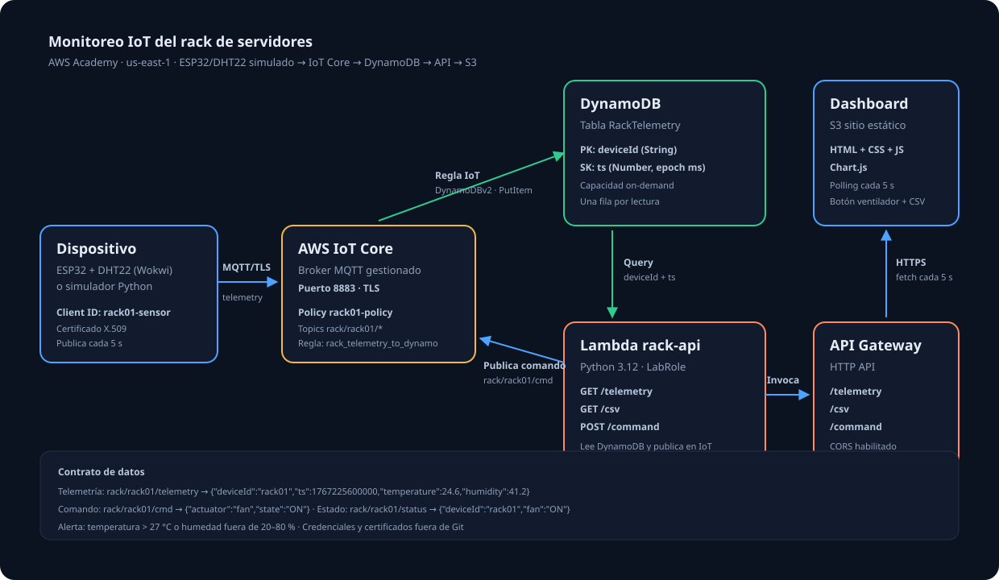

# Monitoreo IoT de un rack de servidores en AWS

Práctica de la especialización (UAO): un dispositivo ESP32 + sensor DHT22 (simulado) envía temperatura y humedad de un
**rack de servidores** por MQTT a **AWS IoT Core**; los datos se guardan en **DynamoDB** y se visualizan en un dashboard
alojado en **S3** (web estática) que permite **controlar un ventilador** de forma remota y **descargar los datos en CSV**.

> Demo: `http://TU-BUCKET.s3-website-us-east-1.amazonaws.com` ← reemplazar por tu endpoint real.



## Caso de uso
Si falla la climatización de una sala de servidores, la temperatura del rack sube y puede dañar equipos.
El sistema mide temperatura y humedad, alerta cuando la temperatura supera **27 °C** (o la humedad sale de 20–80 %)
y permite encender un ventilador de enfriamiento desde el navegador.

## Arquitectura
```
Dispositivo (ESP32 / simulador)
   │ MQTT sobre TLS (8883, certificado X.509)
   ▼
AWS IoT Core ── Regla IoT (SELECT * FROM 'rack/+/telemetry') ──► DynamoDB: RackTelemetry
   ▲                                                                  ▲
   │ publica rack/rack01/cmd                                          │ Query
Lambda rack-api ◄── API Gateway (HTTP API) ◄── Dashboard (S3 sitio estático, consulta cada 5 s)
```

| Recurso | Nombre | Función |
|---|---|---|
| IoT Thing | `rack01-sensor` | Representa al dispositivo |
| IoT Policy | `rack01-policy` | Permisos mínimos del certificado |
| Regla IoT | `rack_telemetry_to_dynamo` | Guarda cada lectura en DynamoDB (acción DynamoDBv2) |
| DynamoDB | `RackTelemetry` | PK `deviceId` (S), SK `ts` (N, epoch ms), on-demand |
| Lambda | `rack-api` | Lee lecturas, genera CSV y publica comandos |
| API Gateway | HTTP API | `GET /telemetry`, `GET /csv`, `POST /command` |
| S3 | bucket estático | Hospeda el dashboard |

## Contrato de datos
- Telemetría: `rack/rack01/telemetry` → `{"deviceId":"rack01","ts":1767225600000,"temperature":24.6,"humidity":41.2}`
- Comando: `rack/rack01/cmd` → `{"actuator":"fan","state":"ON"}`
- Estado: `rack/rack01/status` → `{"deviceId":"rack01","fan":"ON"}`

La fuente de verdad de topics, payloads y umbrales está en [`constitution.md`](constitution.md).

## Estructura del repo
```
├── device/simulador.py        # ESP32 simulado (paho-mqtt)
├── lambda/lambda_function.py  # Lambda rack-api
├── iot/                       # policy de ejemplo y SQL de la regla
├── dashboard/                 # index.html, style.css, app.js, config.js
├── docs/                      # guías, diagrama y capturas
├── constitution.md  AGENTS.md
└── certs/                     # NO se sube (ver .gitignore)
```

## Requisitos
- Cuenta de **AWS Academy Learner Lab** con la región `us-east-1` (o la del lab).
- Python 3.10+ y `paho-mqtt` para el simulador.
- Un navegador moderno; el dashboard no requiere build.
- Opcional: cuenta de **Wokwi** para el ESP32 virtual.

## Paso a paso (resumen)
Todo se hizo por consola en **AWS Academy (Learner Lab, us-east-1)**, usando `LabRole` cuando un servicio pide un rol.
La guía detallada está en [`docs/02-guia-aws-paso-a-paso.md`](docs/02-guia-aws-paso-a-paso.md).

1. **AWS IoT Core → Thing** `rack01-sensor` con certificado autogenerado; se descargan certificado, clave privada y `AmazonRootCA1.pem`.
2. **Policy** `rack01-policy` (ver `iot/rack01-policy.example.json`) con el ARN real de la cuenta y la región. Se asocia al certificado.
3. **Endpoint:** `aws iot describe-endpoint --endpoint-type iot:Data-ATS` (o IoT Core → Connect → Domain configurations).
4. **DynamoDB:** tabla `RackTelemetry`, partition key `deviceId` (String), sort key `ts` (Number), capacidad on-demand.
5. **Regla IoT** con el SQL de `iot/rule.sql` y acción **DynamoDBv2** hacia `RackTelemetry` con `LabRole`.
6. **Simulador:** `pip install paho-mqtt`, copiar los certificados a `certs/` como `AmazonRootCA1.pem`, `device.pem.crt`, `private.pem.key` y ejecutar:
   ```bash
   # Linux/macOS
   export IOT_ENDPOINT=xxxx-ats.iot.us-east-1.amazonaws.com
   python device/simulador.py
   ```
   ```powershell
   # PowerShell
   $env:IOT_ENDPOINT="xxxx-ats.iot.us-east-1.amazonaws.com"
   python device/simulador.py
   ```
7. **Lambda** `rack-api` (Python 3.12, rol `LabRole`, timeout 15 s, variables `TABLE_NAME` e `IOT_ENDPOINT`) con el código de `lambda/`.
8. **API Gateway (HTTP API)** con las rutas `GET /telemetry`, `GET /csv` y `POST /command` hacia la Lambda y CORS (origen `*`, métodos GET/POST/OPTIONS, header `content-type`).
9. **Dashboard:** poner la URL de la API en `dashboard/config.js`, subir los 4 archivos a la raíz de un bucket S3 con *Static website hosting* y una bucket policy de lectura pública (`s3:GetObject`).

> `dashboard/config.js` trae un placeholder (`https://TU-API-ID...`). Cámbialo por el **Invoke URL** real antes de subir el dashboard.

## Verificación
- Filas nuevas cada ~5 s en DynamoDB (Explore items) → criterio de **funcionalidad**.
- Conexión MQTT estable, `Conectado, código: Success` y publicación continua → criterio de **comunicación**.
- Dashboard con tarjetas, gráfica, alerta, control del ventilador y CSV → criterio de **diseño**.

## Problemas encontrados (y solución)
| Problema | Causa | Solución |
|---|---|---|
| El dispositivo se conectaba y se desconectaba (`Unspecified error`) | La policy quedó con los marcadores `<REGION>` y `<ACCOUNT_ID>` sin reemplazar | Nueva versión de la policy con los datos reales |
| La regla mostraba error de `AttachRolePolicy` | Academy no deja modificar `LabRole` desde la consola | La regla igual quedó guardada con `LabRole`; se comprobó con los logs de IoT |
| No se podía publicar en el MQTT test client | Se publicaba en un topic con comodín (`rack/#`) | Publicar en un topic exacto |
| Temperatura del simulador pegada en 35 °C | Modelo con deriva sin control | Modelo que tiende a un valor objetivo y reacciona al ventilador |
| "Policy has invalid resource" en S3 | Nombre del bucket mal escrito en el `Resource` | Usar el nombre real: `arn:aws:s3:::BUCKET/*` |

## Seguridad
- `certs/` está en `.gitignore`: **nunca** se suben certificados ni claves privadas.
- Las policies siguen mínimo privilegio. El CORS `*` y la lectura pública del bucket son solo para la práctica.
- El endpoint de la API no tiene autenticación: cualquiera con la URL puede leer datos o enviar comandos mientras el lab esté activo. Para producción se agregaría autenticación (Cognito/JWT) y CORS restringido.

## Limpieza
Eliminar regla IoT, Thing, certificado y policy, tabla DynamoDB, API Gateway, Lambda y bucket S3 (vaciarlo antes).

## Documentación
| Archivo | Contenido |
|---|---|
| [`docs/01-arquitectura.md`](docs/01-arquitectura.md) | Visión general y decisiones de diseño |
| [`docs/02-guia-aws-paso-a-paso.md`](docs/02-guia-aws-paso-a-paso.md) | Creación de recursos en AWS |
| [`docs/03-dispositivo-wokwi-y-simulador.md`](docs/03-dispositivo-wokwi-y-simulador.md) | ESP32 en Wokwi y simulador Python |
| [`docs/04-dashboard-y-despliegue.md`](docs/04-dashboard-y-despliegue.md) | Dashboard, CSV y hosting en S3 |
| [`docs/05-checklist-y-presentacion.md`](docs/05-checklist-y-presentacion.md) | Evaluación y pruebas finales |
| [`docs/06-guia-de-estudio.md`](docs/06-guia-de-estudio.md) | Explicación completa del trabajo para estudiar |
| [`docs/07-guia-de-sustentacion.md`](docs/07-guia-de-sustentacion.md) | Guion paso a paso para la sustentación |

> Capturas: agrega las evidencias reales en `docs/img/` (por ejemplo `dashboard.png`) cuando las tengas disponibles.

## Autor
Julian — jdcg5299 · Especialización en IA y Cloud Computing, Universidad Autónoma de Occidente
