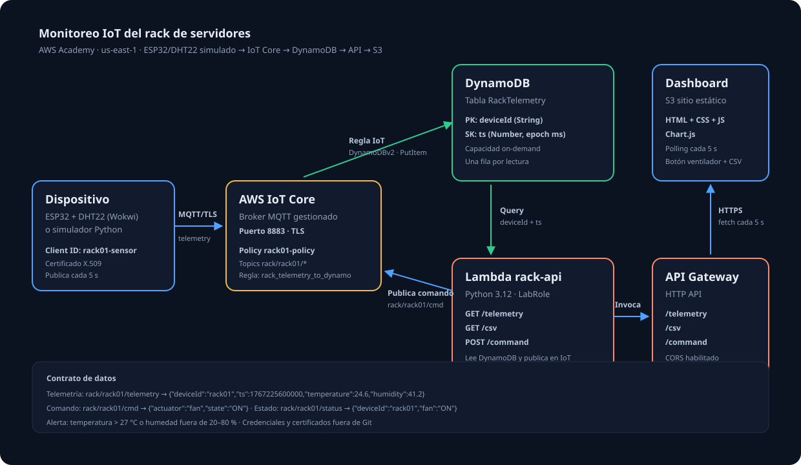

# 01 — Arquitectura



## Caso de uso
Un rack de servidores se sobrecalienta si falla la climatización. El sensor DHT22 mide temperatura y humedad de la entrada de aire;
si la temperatura sube del umbral, el operador puede **encender un ventilador/extractor** (actuador) desde el dashboard.

## Diagrama
```
 ESP32 + DHT22 (Wokwi o simulador)
   │  MQTT/TLS 8883  (certificado X.509)
   ▼
 AWS IoT Core ──(Regla IoT: SELECT * FROM 'rack/+/telemetry')──► DynamoDB  RackTelemetry
   ▲                                                                  ▲
   │ publish rack/rack01/cmd                                          │ Query
   │                                                                  │
 Lambda "rack-api" ◄──── API Gateway (HTTP API) ◄──── Dashboard (S3 sitio estático, fetch cada 5 s)
```

## Por qué cada pieza
| Servicio | Rol | Por qué |
|---|---|---|
| AWS IoT Core | Broker MQTT gestionado | Autentica el dispositivo con certificado y enruta mensajes |
| Regla IoT | Enrutamiento | Guarda cada mensaje en DynamoDB sin escribir código |
| DynamoDB | Base de datos | Series de tiempo simples: PK `deviceId`, SK `ts` permite consultar por rango |
| Lambda | Lógica de API | Lee datos, genera CSV y publica comandos al actuador |
| API Gateway (HTTP API) | Puerta HTTPS | El navegador no puede hablar con DynamoDB directamente sin credenciales |
| S3 (static website) | Hosting | Sirve HTML/JS/CSS del dashboard |

## Decisión: ¿por qué un API y no MQTT directo desde el navegador?
MQTT sobre WebSockets desde el navegador exige credenciales AWS (Cognito Identity Pool + roles IAM propios),
y en AWS Academy no se pueden crear roles. Con API Gateway + Lambda (que usa `LabRole`) evitamos el problema.
El dashboard "casi tiempo real" se logra con **polling cada 5 s**.

## Flujo del actuador
Dashboard → `POST /command` → Lambda → `iot-data:Publish` a `rack/rack01/cmd` → dispositivo suscrito enciende el relé/LED →
publica `rack/rack01/status` → (opcional) se guarda y el dashboard lo refleja.
